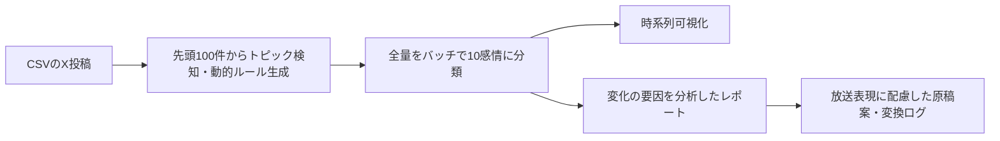

# 災害時のSNS感情遷移分析

## 概要

学部の卒業論文として、テレビ局との企業連携PBLで作った研究用プロトタイプです。災害時のX投稿をGeminiで分類し、感情の時系列変化と背景要因を、報道担当者が確認できる形にします。放送原稿案も生成しますが、報道判断を自動化するものではありません。

## 背景と課題

災害報道で伝えられる情報と、被災した人がその時に知りたい情報にはずれが生じ得ます。テレビ局側には、投稿が増えた事実だけでなく、**人々の感情がなぜ変わったのか**を知りたいという課題がありました。

## 方向転換の判断

当初は投稿に含まれる地名から被害地域を可視化する案を検討しました。しかし、既存システムと役割が重なるため断念しました。そこで「事実が起きてから報道されるまでの間」に着目し、感情の変化とその理由を報道の現場へ届ける方向に切り替えました。一般的なEkman・Plutchikの感情モデルでは災害時の文脈を捉えきれないと考え、災害特化の10感情を定義しました。

## 本人の役割と現在の段階

技術リーダーとして、課題の提示、方向転換、感情モデルの設計、分析方法の検討、提案を主導しました。学生メンバーは主にデータ収集を手伝いました。**実装には、生成AIを活用しました。** 現在は研究用プロトタイプと事例検証の段階で、放送現場への導入や運用効果の実証は行っていません。

## 検証の規模と結果

主要な地震8事例の投稿約12,000件を対象にし、全8事例に共通する感情推移パターンを確認しました。パラメータ攪乱テストで得た**信頼性89%**は、条件を変えた際の分析結果の安定性を示します。逆推定法で得た**妥当性84%**は、感情の数値的な変化から推定した要因と分析結果の整合を示します。いずれも人手による正解ラベルとの一致率を意味しません。

## 処理の流れ

主解析ではGeminiのTemperatureを0.0に設定し、出力の揺れを抑えています。画面の追加のAI検証では別の設定を使うため、全機能の出力が常に同一になるという意味ではありません。

## 災害特化10感情モデル

恐怖、衝撃、不安、心配、悲しみ、怒り、嫌悪、連帯、安堵、冷静の10種類です。例えば「自分の今後への不安」と「他者の安否を心配する気持ち」を分けて扱います。投稿を期間ごとに集計し、変化の背景をレポートにします。

## 放送倫理への配慮

生成した放送原稿案では、過激な言葉を意味を保ちながら放送基準に沿う表現へ言い換える方針を設け、変換前後と理由を表示します。未確認情報や個人情報を含む可能性があるため、公開・放送前には担当者による確認が必要です。

## スポーツ版の位置づけ

[`soccer_sns_analyzer`](soccer_sns_analyzer/) は、災害とは別のドメインでも手法を試すための派生版です。サッカー日本代表戦の投稿約2,000件で検証しました。災害版と感情カテゴリや期間の切り方は異なり、スポーツ中継での運用効果を示すものではありません。

## 使い方

1. [`disaster_sns_analyzer/index.html`](disaster_sns_analyzer/index.html) をローカルのブラウザで開きます。スポーツ版は [`soccer_sns_analyzer/index.html`](soccer_sns_analyzer/index.html) を開きます。
2. 設定画面で自分のGemini APIキーを入力します。キーはページを開いている間だけメモリに保持し、再読み込みで消えます。
3. CSVを読み込み、分析結果・グラフ・レポートを確認します。災害版のCSVはB列が投稿日時、C列が投稿文です。

ブラウザからGemini APIを直接呼ぶ**ローカル用デモ**です。キーがブラウザの通信で使われるため、共有端末や公開環境で入力しないでください。旧版がブラウザに保存したキーは起動時に削除します。投稿と分析結果の履歴はブラウザ内に保存されるため、実データを扱う際は権利・プライバシーに注意してください。画面はPapa ParseとChart.jsをCDNから読み込む構成で、表示・分析にはネットワーク接続が必要です。

## 限界と今後

- 投稿は被災者全体を代表しません。分類・要因推定・原稿案にはLLMの誤りがあり得ます。
- 信頼性・妥当性の検証は限定された事例と方法によるもので、独立した人手評価や放送現場での有効性評価は今後の課題です。
- 次の段階では、人手による評価、災害種別を広げた検証、報道担当者との利用評価を進めたいと考えています。

使用技術: JavaScript、Gemini API、Papa Parse、Chart.js。
